# StockFlow – Entity Relationship Diagram

The database schema for StockFlow (MySQL 8 / MariaDB 10.4+). The tables are defined in [`server/src/db/schema.js`](server/src/db/schema.js).

Legend: `PK` primary key, `FK` foreign key, `UK` unique. Solid lines are foreign keys. Dotted lines are references without a foreign key (see [Stock ledger](#stock-ledger)).

```mermaid
erDiagram
    users {
        int id PK
        varchar name
        varchar email UK
        varchar password_hash
        timestamp password_changed_at "tokens issued before this are refused"
        enum role "admin | manager | staff"
        tinyint is_active
        timestamp created_at
        timestamp updated_at
    }

    user_preferences {
        int user_id PK, FK
        varchar pref_key PK "e.g. products.grid.columns"
        json value
        timestamp updated_at
    }

    categories {
        int id PK
        varchar code UK "LAP, MON, CBL..."
        varchar name UK
        varchar description
        timestamp created_at
    }

    products {
        int id PK
        varchar sku UK
        varchar name
        int category_id FK
        varchar brand
        varchar unit "pcs | box | set | roll"
        decimal cost_price
        decimal sale_price
        int min_stock "low-stock alert level"
        varchar image_url
        text description
        tinyint is_active
        int version "optimistic locking"
        timestamp created_at
        timestamp updated_at
    }

    warehouses {
        int id PK
        varchar code UK "HN, HCM, DN"
        varchar name
        varchar city
        varchar address
        tinyint is_active
        timestamp created_at
    }

    stock {
        int product_id PK, FK
        int warehouse_id PK, FK
        int quantity "CHECK >= 0"
        int version "optimistic locking"
        timestamp updated_at
    }

    stock_movements {
        bigint id PK
        int product_id FK
        int warehouse_id FK
        enum type "opening | purchase_receipt | sale | sale_cancel | transfer_in | transfer_out | adjustment"
        int quantity_change "signed, never 0"
        int balance_after "CHECK >= 0"
        enum reference_type "purchase_order | sales_order | stock_transfer"
        int reference_id
        varchar note
        int user_id FK
        datetime created_at
    }

    stock_transfers {
        int id PK
        varchar transfer_number UK
        int product_id FK
        int from_warehouse_id FK
        int to_warehouse_id FK "CHECK from <> to"
        int quantity "CHECK > 0"
        varchar note
        int created_by FK
        datetime created_at
    }

    suppliers {
        int id PK
        varchar code UK
        varchar name
        varchar contact_name
        varchar email
        varchar phone
        varchar city
        varchar address
        varchar notes
        tinyint is_active
        timestamp created_at
        timestamp updated_at
    }

    purchase_orders {
        int id PK
        varchar po_number UK
        int supplier_id FK
        int warehouse_id FK "delivered to"
        enum status "draft | approved | received | cancelled"
        datetime order_date
        date expected_date
        decimal total_amount
        varchar note
        int created_by FK
        int approved_by FK
        datetime approved_at
        int received_by FK
        datetime received_at
        int cancelled_by FK
        datetime cancelled_at
        varchar cancel_reason
        int version "optimistic lock for draft edits"
        timestamp created_at
        timestamp updated_at
    }

    purchase_order_items {
        int id PK
        int purchase_order_id FK "UK with product_id"
        int product_id FK
        int quantity "CHECK > 0"
        decimal unit_cost
        decimal line_total
    }

    customers {
        int id PK
        varchar code UK
        varchar name
        varchar contact_name
        varchar email
        varchar phone
        varchar city
        varchar address
        varchar notes
        tinyint is_active
        timestamp created_at
        timestamp updated_at
    }

    sales_orders {
        int id PK
        varchar order_number UK
        int customer_id FK
        int warehouse_id FK "ships from"
        enum status "completed | cancelled"
        datetime order_date
        decimal subtotal
        decimal discount
        decimal total_amount
        varchar note
        int created_by FK
        int cancelled_by FK
        datetime cancelled_at
        varchar cancel_reason
        timestamp created_at
        timestamp updated_at
    }

    sales_order_items {
        int id PK
        int sales_order_id FK "UK with product_id"
        int product_id FK
        int quantity "CHECK > 0"
        decimal unit_price "copied at time of sale"
        decimal unit_cost "copied at time of sale, for profit"
        decimal line_total
    }

    audit_logs {
        bigint id PK
        int user_id FK "SET NULL on user delete"
        varchar action
        varchar entity_type
        int entity_id
        json changes "old and new values"
        varchar ip_address
        datetime created_at
    }

    %% Catalog and stock
    categories ||--o{ products : "groups"
    products ||--o{ stock : "stocked as"
    warehouses ||--o{ stock : "holds"
    products ||--o{ stock_movements : "moved"
    warehouses ||--o{ stock_movements : "at"
    users ||--o{ stock_movements : "made by"

    %% Transfers between warehouses
    products ||--o{ stock_transfers : "transferred"
    warehouses ||--o{ stock_transfers : "from / to"
    users ||--o{ stock_transfers : "created by"

    %% Buying
    suppliers ||--o{ purchase_orders : "supplies"
    warehouses ||--o{ purchase_orders : "receives"
    users ||--o{ purchase_orders : "creates / approves / receives / cancels"
    purchase_orders ||--|{ purchase_order_items : "contains"
    products ||--o{ purchase_order_items : "ordered as"

    %% Selling
    customers ||--o{ sales_orders : "places"
    warehouses ||--o{ sales_orders : "ships"
    users ||--o{ sales_orders : "creates / cancels"
    sales_orders ||--|{ sales_order_items : "contains"
    products ||--o{ sales_order_items : "sold as"

    %% Audit and settings
    users |o--o{ audit_logs : "performed"
    users ||--o{ user_preferences : "saves"

    %% Ledger references (no foreign key, see notes)
    purchase_orders ||..o{ stock_movements : "receipt"
    sales_orders ||..o{ stock_movements : "sale / cancel"
    stock_transfers ||..|{ stock_movements : "out + in"
```



## Relationships

| From | To | Type | Meaning |
| ---- | -- | ---- | ------- |
| categories | products | 1 – many | Each product belongs to one category |
| products × warehouses | stock | 1 row per pair | Current quantity of a product in a warehouse |
| stock (product, warehouse) | stock_movements | 1 – many | Every change to that quantity, in order |
| suppliers | purchase_orders | 1 – many | A purchase order buys from one supplier |
| purchase_orders | purchase_order_items | 1 – 1..many | Lines of the order, one per product |
| customers | sales_orders | 1 – many | A sales order is for one customer |
| sales_orders | sales_order_items | 1 – 1..many | Lines of the order, one per product |
| warehouses | purchase_orders / sales_orders | 1 – many | Where goods arrive / ship from |
| warehouses | stock_transfers | 1 – many (twice) | Source and destination warehouse |
| users | orders, transfers, movements | 1 – many | Who created, approved, received or cancelled |
| users | audit_logs | 0..1 – many | Who did it; kept as NULL if the user is deleted |
| users | user_preferences | 1 – many | Saved UI settings (e.g. grid columns); deleted with the user |

## Design notes

### Stock ledger

- **`stock`** holds the current quantity, one row per product per warehouse.
- **`stock_movements`** is the ledger. Every change to `stock` writes one movement in the same transaction, so a quantity can always be explained:

  ```
  stock.quantity = SUM(stock_movements.quantity_change)  -- per product and warehouse
  ```

- **`reference_type` + `reference_id`** point to whatever caused the movement: a purchase order, a sales order or a stock transfer. Because a single column can point to one of three tables, it can't be a foreign key; the application sets it, and it is indexed for lookups. A transfer creates two movements, `transfer_out` at the source and `transfer_in` at the destination.

### Integrity in the database

- **`CHECK` constraints:** `stock.quantity >= 0`, `balance_after >= 0`, and order line quantities `> 0`. Even a bug in application code can't oversell or store an empty line.
- **Unique `(order_id, product_id)` on order items:** a product appears once per order; more units means a higher quantity.
- **Deleting an order deletes its items** (`ON DELETE CASCADE`). Orders themselves are cancelled rather than deleted, so their history stays.

### Prices and history

- **Order items copy the price** at the time of the order (`unit_price`, `unit_cost`), so changing a product's price never changes old orders or invoices.
- **Money is stored as `DECIMAL`,** never floating point.

### Concurrency

- **`version` columns** on `stock` and `products` support optimistic locking: an update includes `WHERE version = ?`, and if another user changed the row first, 0 rows are updated and the request is retried or rejected.
- The alternative for stock is `SELECT ... FOR UPDATE` inside the order transaction.

### Roles

- **Role is a column on `users`,** not a separate table. What each role is allowed to do is defined in code ([`server/src/auth/permissions.js`](server/src/auth/permissions.js)), so permissions are versioned and reviewed together with the routes that check them.
